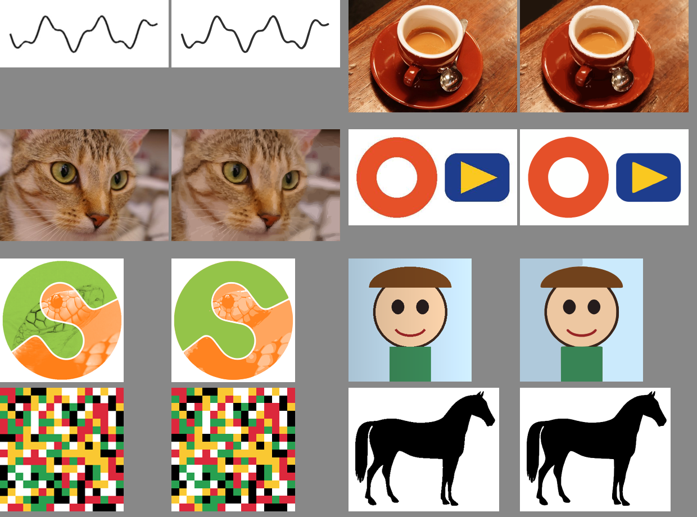

# TraceForge

**Transforme imagens em SVG com uma interface de arrastar e soltar, CLI ou Python.**

Logos, ilustrações, assinaturas e pixel art recebem tratamentos diferentes. O pipeline classifica a entrada, prepara a imagem, testa candidatos com VTracer e escolhe o resultado pelo equilíbrio entre fidelidade e complexidade. Roda em CPU; o fluxo padrão não usa APIs pagas, GPU ou serviços externos.

[](https://github.com/Vitt2909/traceforge/actions/workflows/ci.yml)
[](https://codespaces.new/Vitt2909/traceforge)



## Começar

Use Python **3.10 ou superior** (3.12 recomendado). Clone o projeto e instale em um ambiente virtual:

```bash
git clone https://github.com/Vitt2909/traceforge.git
cd traceforge
python -m venv .venv
```

Ative o ambiente:

```bash
# macOS / Linux
source .venv/bin/activate
```

```powershell
# Windows PowerShell
.venv\Scripts\Activate.ps1
```

Instale e inicie:

```bash
python -m pip install -e ".[web]"
traceforge-web
```

Abra **http://127.0.0.1:8000**, escolha uma imagem, clique em **Vetorizar**, compare as prévias e baixe o SVG. `python -m traco.web` é uma alternativa se o comando não estiver no PATH. No Windows, também é possível executar `.venv\Scripts\python.exe -m traco.web` sem ativar o ambiente.

**Pelo navegador, sem instalar localmente:** abra o botão Codespaces acima. Após preparar o ambiente, a porta 8000 abre a interface. O processamento acontece na máquina do Codespaces; o serviço tem cotas e possíveis custos definidos pelo GitHub. Isso ainda não é a futura versão WASM que processará tudo no próprio navegador.

## Linha de comando

```bash
traceforge logo.png
traceforge logo.jpg -o saida/logo.svg -t --relatorio
traceforge personagem.png -q best
traceforge "pasta/*.png" -o saida/
traceforge foto.jpg -p illustration -c 12
python -m traceforge logo.png
```

| Opção | Comportamento |
|---|---|
| `-o, --saida` | Arquivo `.svg` ou pasta; cria diretórios necessários |
| `-p, --preset` | `auto`, `logo`, `illustration`, `lineart`, `pixel`, `photo` |
| `-q, --qualidade` | `fast`: 1 candidato; `balanced`: até 3; `best`: até 6; pixel art usa 1 |
| `-c, --cores` | Máximo de 2–64 cores, apenas nos presets `logo` e `illustration` |
| `-t, --transparente` | Remove fundo uniforme conectado às bordas |
| `--relatorio` | Salva JSON com SSIM, ΔE76, caminhos, paleta e candidatos |
| `--ia-fundo` | Remoção de fundo opcional; instale `python -m pip install -e ".[ai]"`; baixa pesos na primeira execução |
| `--otimizar` | Tenta executar SVGO via `npx`; exige Node.js e pode baixar o pacote. Se indisponível, mantém o SVG |

`traco`, `traco-web` e `from traco import vectorize` continuam funcionando por compatibilidade com o projeto original. Não é necessário instalar um pacote chamado `traco` do PyPI. Uma saída existente com o mesmo nome será substituída; imagens de entrada são protegidas contra sobrescrita.

## Python

```python
from pathlib import Path
from traceforge import vectorize

result = vectorize("logo.png", transparent=True, quality="balanced")
Path("logo.svg").write_text(result.svg, encoding="utf-8")
print(result.report())
```

## API local

```bash
curl -F "arquivo=@logo.png" -F "qualidade=balanced" \
  http://127.0.0.1:8000/api/vetorizar -o logo.svg
```

`POST /api/vetorizar` aceita `arquivo`, `preset`, `qualidade`, `cores` e `transparente`. Retorna SVG, nome de download em UTF-8 e métricas no cabeçalho `X-TraceForge-Report`. Documentação interativa em `/docs`; saúde em `/healthz`. Entrada inválida recebe 400/422, arquivo acima de 20 MB recebe 413 e outra conversão em andamento recebe 503.

## Docker

```bash
docker build -t traceforge .
docker run --rm -p 127.0.0.1:8000:8000 traceforge
```

O serviço foi feito para uso local e não tem autenticação. Para hospedagem pública, configure autenticação, limites de corpo de requisição, concorrência, tempo de processamento e recursos no proxy/ambiente de execução. O limite da aplicação é aplicado após o parser multipart do servidor. Uploads podem usar arquivos temporários, encerrados após a leitura. Imagens não são enviadas a APIs externas pelo pipeline padrão.

## Fluxo e limites

1. **Entrada:** PNG, JPG, WebP, GIF, BMP e TIFF. Corrige EXIF e usa o primeiro quadro de animações. Outros formatos dependem dos codecs do Pillow.
2. **Análise:** heurística para logo, ilustração, traço, foto ou pixel art; o preset manual permite corrigir a classificação.
3. **Pré-processamento:** redução de ruído, ampliação, paleta aprendida em regiões planas e suavização de rótulos por votação.
4. **Traçado:** VTracer 0.6.x em camadas; pixel art usa retângulos por cor e opacidade, preservando pixels.
5. **Saída:** SVG com `viewBox`, título escapado e dimensões originais.
6. **Avaliação:** rasteriza com resvg, compara SSIM/ΔE76 em fundo branco e aplica uma penalidade de complexidade. A pontuação é uma heurística, não uma garantia de qualidade perceptual.

- Máximo de **20 MB e 20 megapixels**. O processamento reduz o maior lado a 4096 px, mas mantém as dimensões originais no SVG.
- Fotos geram muitos caminhos e arquivos grandes. Para um resultado mais leve e estilizado, use `-p illustration -c 12`.
- Fora do preset pixel, a transparência é simplificada para opaco/transparente; degradês viram faixas de cores sólidas.
- Texto vira contorno, não fonte editável. Assinaturas usam contornos, **não centerline**.
- O modo automático pode classificar pequenas artes como pixel art. Use `-p logo` quando desejar curvas.
- A v0.1 não inclui WASM, StarVector, DiffVG, paleta fixa, reconhecimento de primitivas ou conectores pagos.

## Desenvolvimento e verificação

```bash
python -m pip install -e ".[dev]"
python -m pytest -q
python -m build
```

A suíte cobre o pipeline, transparência, imagens pequenas, validação, arquivos em lote, API, nomes Unicode e disponibilidade do servidor durante conversões. O CI testa Python 3.10/3.12 em Linux, Windows e macOS e instala a wheel fora do repositório para conferir o empacotamento da interface.

Os exemplos e a comparação visual foram recebidos com a versão inicial. Seus números históricos não são um benchmark independente. Para reproduzir as métricas na sua máquina:

```bash
traceforge "exemplos/entrada/*" -o resultados/ --relatorio
```

Veja [SOLUCOES.md](SOLUCOES.md) para as notas de pesquisa e o roadmap.

## Licença

Código do TraceForge sob [MIT](LICENSE). Dependências e materiais de terceiros mantêm suas próprias licenças. O motor padrão é VTracer; Potrace não está incluído.
