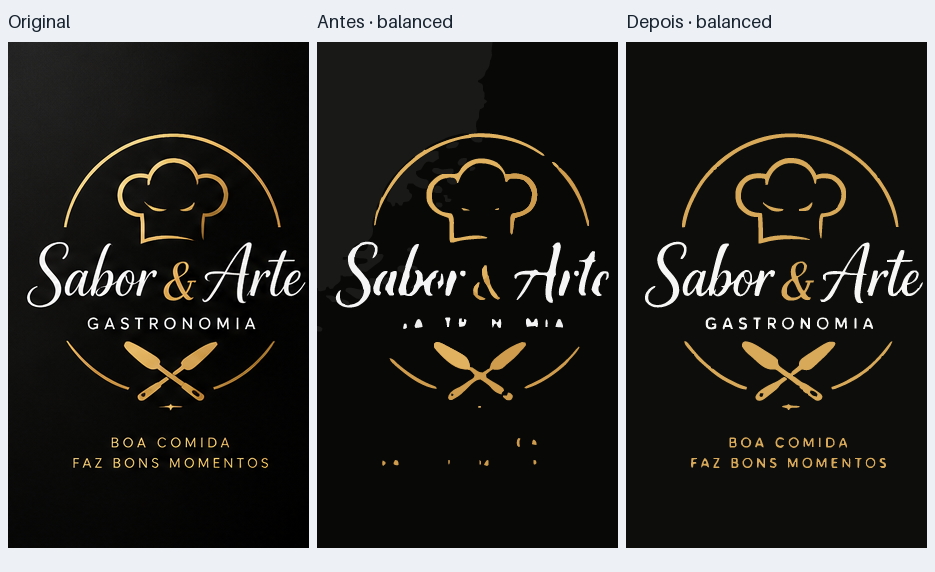
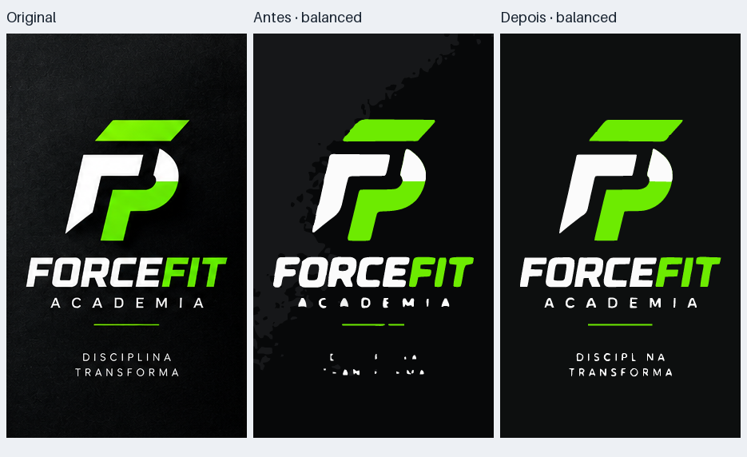
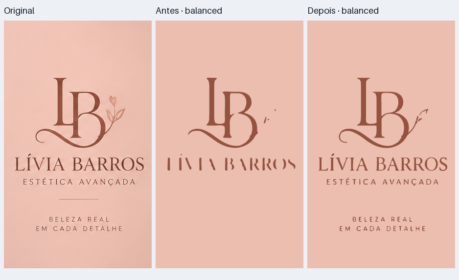
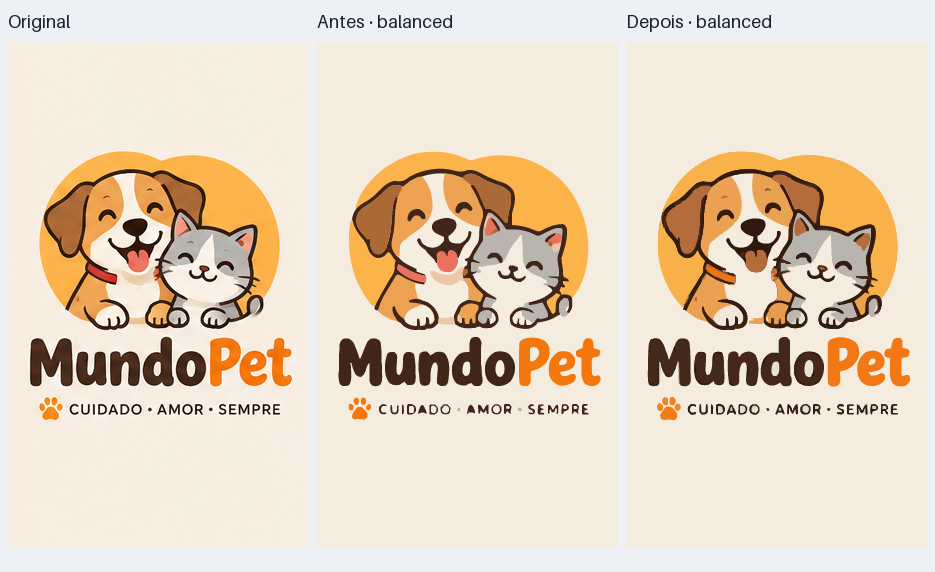
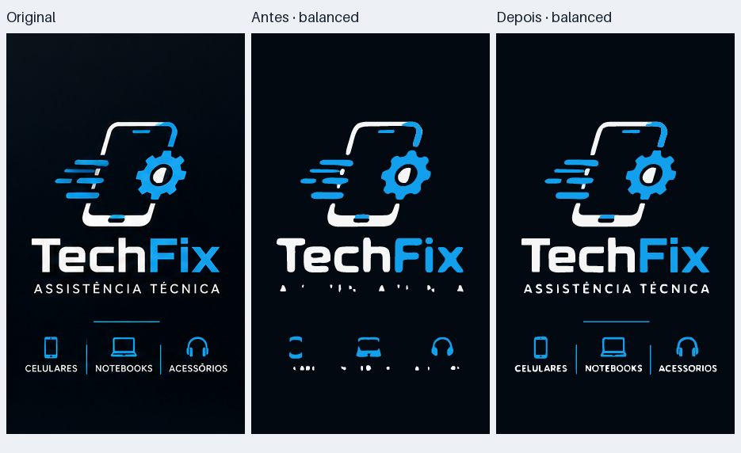
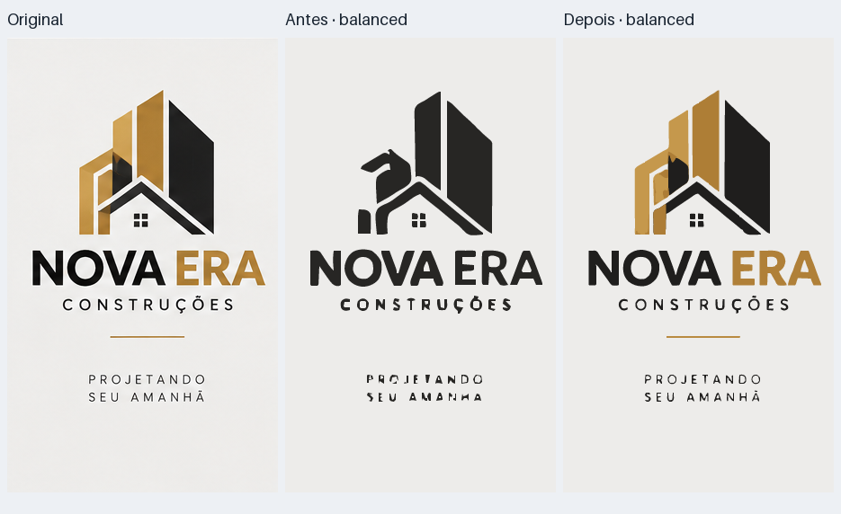
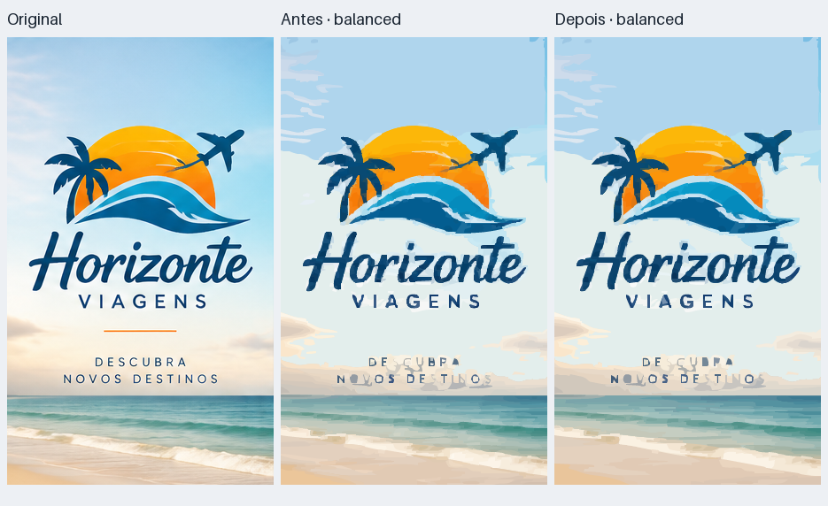
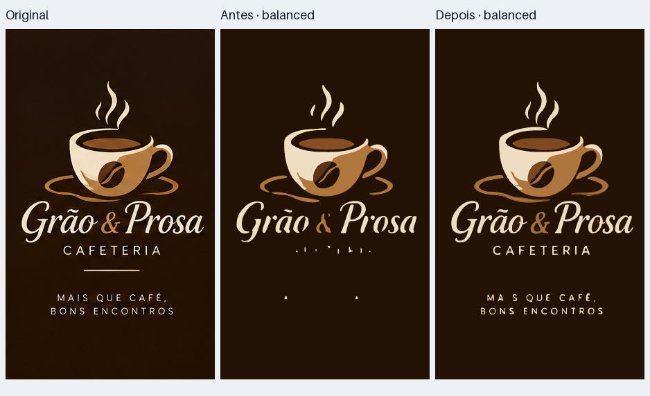
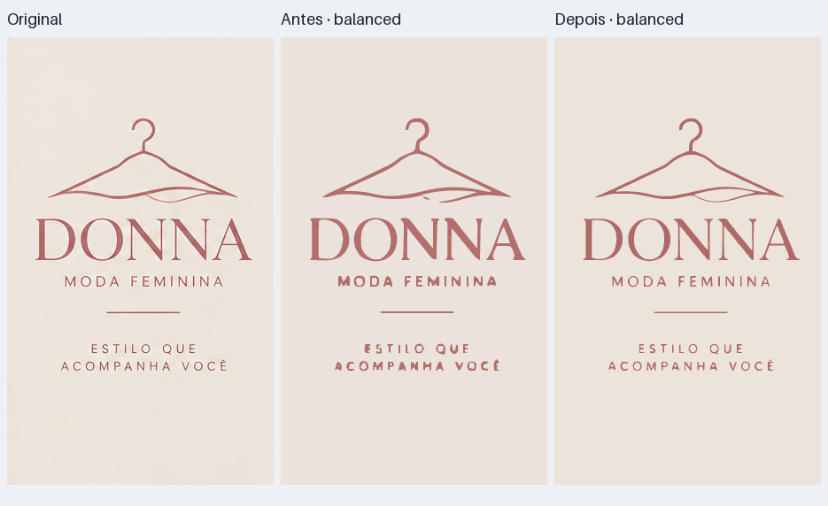
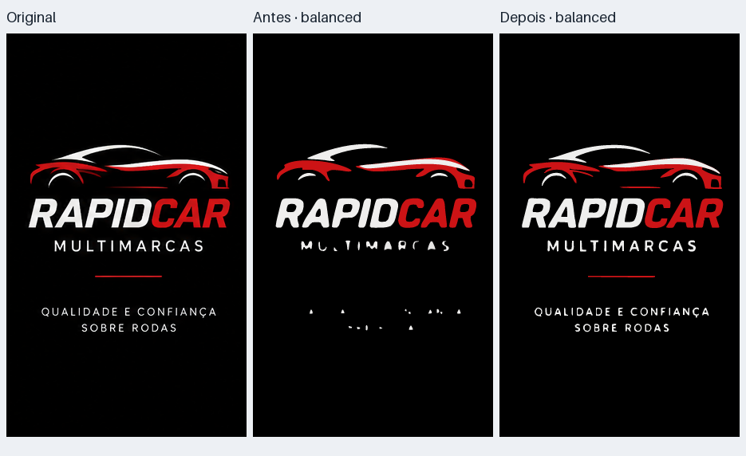

# Comparação dos 10 logos — antes e depois

Medições na mesma máquina Linux/Python 3.12, duas execuções em processos separados por entrada e qualidade. Tempo: mediana do tempo de conversão, sem importação/instalação nem renderização das pranchas. RAM: pico RSS do processo, incluindo imports, obtido por getrusage; não é memória incremental da função. KB = 1024 bytes. Recortes em grade 5×2, margem interna de 3 px, sem redimensionar. SHA-256 da grade: 9d57d03ee7627ba9bf75833092de1234a101af8ea18c33b1be36591f96b35dbd. Baseline: commit 1cb321a79c89f713366d4b676e762339073001c7. O script de benchmark foi adicionado nesta correção e é idêntico antes/depois.

O Nova Era perdeu o dourado no baseline. O RapidCar ficou no limite da classificação antiga (saturação média 0,10027; corte em 0,10), mas não virou lineart nestes recortes nem no ZIP sem margem. A falha do retângulo preto foi reproduzida forçando o caminho lineart e coberta por regressões de polaridade, cor e validação. Não se apresenta esse caso forçado como resultado automático medido na tabela. SSIM global pode cair quando texturas do fundo são simplificadas, mesmo com letras preservadas; a nova nota combina bordas, componentes pequenos e fidelidade de cor. Ela não certifica reconhecimento de texto/OCR. SVGs podem crescer para representar os detalhes que antes eram apagados. Horizonte contém fotografia e mantém o aviso de revisão dos detalhes.

No RapidCar forçado para lineart, o baseline produziu fundo preto com SSIM 0,803. O avaliador novo atribui nota 0,0415 e status rejected a esse SVG; a saída automática corrigida recebe 0,8197. Nos 10 logos, best não melhorou a saída sobre balanced, mas seu custo médio adicional caiu de 93% para 9%; a busca parou após 2 candidatos em 8 logos e após 3 em 2 logos.

| Conjunto / qualidade | Tempo (s) | KB | SSIM | ΔE76 | Pico RSS (MB) |
|---|---:|---:|---:|---:|---:|
| Média dos 10 logos / balanced | 1.98 → 0.67 | 61.1 → 65.1 | 0.8785 → 0.9042 | 3.09 → 2.52 | 159.5 → 139.1 |
| Média dos 10 logos / best | 3.81 → 0.73 | 61.2 → 65.1 | 0.8790 → 0.9042 | 3.10 → 2.52 | 166.8 → 139.2 |
| Grade inteira / balanced | 27.93 → 2.83 | 285.6 → 417.4 | 0.8121 → 0.8168 | 4.15 → 4.12 | 304.1 → 251.0 |
| Grade inteira / best | 51.31 → 2.97 | 401.1 → 417.4 | 0.8161 → 0.8168 | 3.47 → 4.12 | 319.5 → 252.6 |

| Entrada | Tempo (s) | KB | SSIM | ΔE76 | Pico RSS (MB) |
|---|---:|---:|---:|---:|---:|
| Sabor & Arte | 1.76 → 0.67 | 26.4 → 33.7 | 0.7986 → 0.7873 | 3.32 → 3.47 | 185.1 → 139.7 |
| ForceFit | 1.88 → 0.65 | 32.9 → 23.5 | 0.7907 → 0.7479 | 2.79 → 3.38 | 178.7 → 140.2 |
| Lívia Barros | 1.48 → 0.62 | 9.4 → 32.8 | 0.8992 → 0.9648 | 2.29 → 1.99 | 154.0 → 139.9 |
| MundoPet | 7.57 → 0.80 | 42.7 → 110.3 | 0.9537 → 0.9592 | 2.37 → 2.39 | 211.1 → 143.8 |
| TechFix | 1.76 → 0.65 | 19.0 → 44.9 | 0.8190 → 0.8724 | 3.08 → 2.25 | 161.4 → 140.6 |
| Nova Era | 0.33 → 0.67 | 22.3 → 32.9 | 0.9165 → 0.9724 | 4.91 → 1.40 | 116.8 → 141.5 |
| Horizonte | 0.93 → 0.67 | 409.9 → 273.3 | 0.8777 → 0.8664 | 5.47 → 5.73 | 117.3 → 121.8 |
| Grão & Prosa | 2.06 → 0.76 | 13.7 → 39.3 | 0.8756 → 0.9296 | 3.08 → 2.43 | 188.3 → 141.7 |
| Donna | 0.33 → 0.63 | 21.1 → 27.3 | 0.9524 → 0.9799 | 1.60 → 1.11 | 116.6 → 141.3 |
| RapidCar | 1.67 → 0.62 | 13.9 → 33.3 | 0.9018 → 0.9622 | 1.95 → 1.07 | 165.7 → 140.3 |
| Grade inteira | 27.93 → 2.83 | 285.6 → 417.4 | 0.8121 → 0.8168 | 4.15 → 4.12 | 304.1 → 251.0 |

## Sabor & Arte

## ForceFit

## Lívia Barros

## MundoPet

## TechFix

## Nova Era

## Horizonte

## Grão & Prosa

## Donna

## RapidCar

[Dados brutos: JSON, SVG e renderizações das duas repetições](benchmark-runs.zip). [Métricas CSV](metrics.csv). [Auditoria de qualidade com a mesma métrica nas duas saídas](quality-audit.json).
